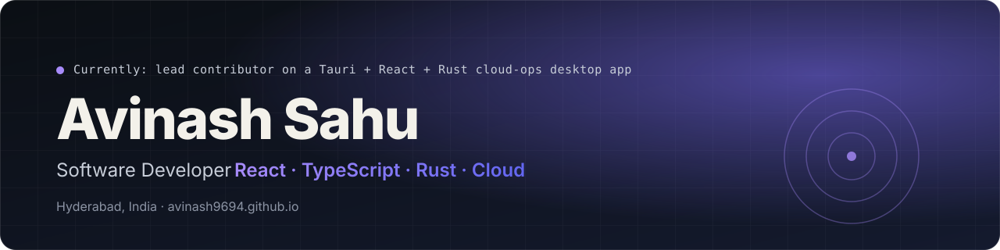
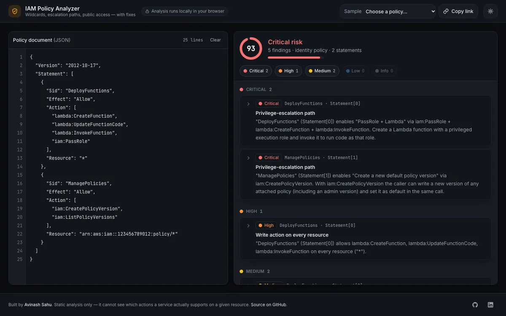
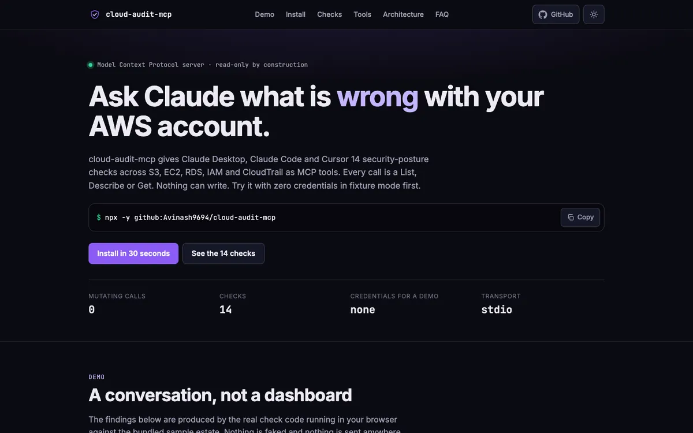
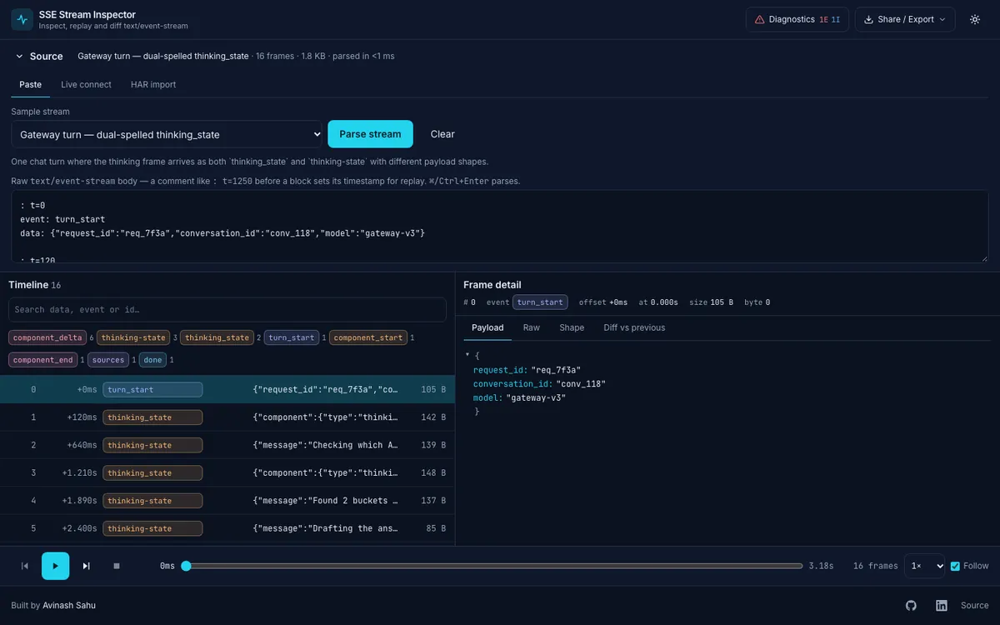
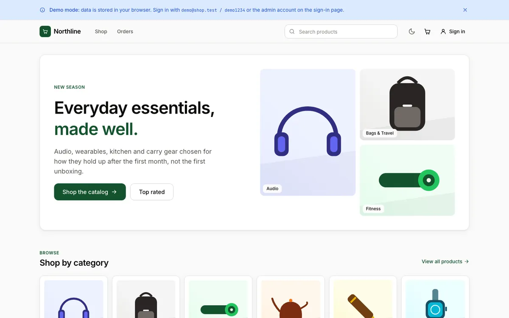

  

Hi, I'm Avinash.

I'm a software developer in Hyderabad. For the last four years I've built web and desktop apps with React, TypeScript and Node.js, mostly on AWS. Right now I work on a desktop app that scans cloud accounts for problems and helps fix them, which in practice means auth flows, streaming UIs, and the edge cases that only show up on a bad network.

I keep a portfolio at [avinash9694.github.io](https://avinash9694.github.io) and my resume is [here](https://avinash9694.github.io/Avinash_Sahu_Resume.pdf). The quickest way to reach me is [avinashsahu1994@gmail.com](mailto:avinashsahu1994@gmail.com); I'm also on [LinkedIn](https://www.linkedin.com/in/A-v-i-n-a-s-h/).

### Things I've built

These all came out of problems I ran into at work. Each one is deployed, so you can try it rather than take my word for it.

<table>
  <tr>
    <td width="50%" valign="top">
      
        
      <b><a href="https://avinash9694.github.io/iam-policy-analyzer/">IAM Policy Analyzer</a></b> &nbsp;·&nbsp; <a href="https://github.com/Avinash9694/iam-policy-analyzer">code</a>
       
      Paste an AWS IAM policy and it tells you what's wrong with it: wildcards, privilege-escalation paths, public access, missing conditions. Each finding comes with a fixed statement you can copy. Nothing leaves your browser.
    </td>
    <td width="50%" valign="top">
      
        
      <b><a href="https://avinash9694.github.io/cloud-audit-mcp/">Cloud Audit MCP Server</a></b> &nbsp;·&nbsp; <a href="https://github.com/Avinash9694/cloud-audit-mcp">code</a>
       
      Lets Claude or Cursor check an AWS account for the usual problems (open security groups, public buckets, users without MFA) through a set of read-only tools. Ships with sample data so you can try it without credentials.
    </td>
  </tr>
  <tr>
    <td width="50%" valign="top">
      
        
      <b><a href="https://avinash9694.github.io/sse-stream-inspector/">SSE Stream Inspector</a></b> &nbsp;·&nbsp; <a href="https://github.com/Avinash9694/sse-stream-inspector">code</a>
       
      A debugger for Server-Sent Events streams, the kind chat backends emit. Paste or record a stream, replay it at the original speed, and see where an event got renamed or its payload changed shape. I built it after exactly that bug cost me a day.
    </td>
    <td width="50%" valign="top">
      
        
      <b><a href="https://avinash9694.github.io/Ecommerce-APP/">Northline</a></b> &nbsp;·&nbsp; <a href="https://github.com/Avinash9694/Ecommerce-APP">code</a>
       
      A full e-commerce app: Express and MongoDB on the back, React on the front, with carts that respect stock, orders that move through a proper status flow, and an admin view. The demo runs entirely in your browser, with no server behind it.
    </td>
  </tr>
</table>

A few more, in the same spirit:

- [IaC Diff Viewer](https://avinash9694.github.io/iac-diff-viewer/) compares two CloudFormation or Terraform files resource by resource and flags the risky changes, like a database being dropped or a port opened to the world. ([code](https://github.com/Avinash9694/iac-diff-viewer))
- [Taste of India Hub](https://avinash9694.github.io/TasteOfIndiaHub/), a recipe site I first built in 2023 and recently rebuilt properly: search by ingredient, filter by region and diet, tick off ingredients as you cook. ([code](https://github.com/Avinash9694/TasteOfIndiaHub))
- [Laundry Cart](https://avinash9694.github.io/Laundry-cart-frontend/), order management for a laundry service, with a four-step order wizard and live pricing. ([frontend](https://github.com/Avinash9694/Laundry-cart-frontend), [API](https://github.com/Avinash9694/Laundry-cart-backend))
- [3D Virtual Environment](https://avinash9694.github.io/3D-Virtual-Environment/), a small three.js world you can walk around in with a chosen avatar. Mostly an excuse to learn WebGL. ([code](https://github.com/Avinash9694/3D-Virtual-Environment))

### What I work with

Day to day: React, TypeScript, Next.js, Tailwind, Node.js, Express and MongoDB, with AWS for most of the infrastructure (Cognito, Lambda, DynamoDB, CloudWatch). I've shipped desktop software with Tauri, set up CI with GitHub Actions, and write tests with Vitest. I'll pick up Rust or WebAssembly when a project calls for it.
