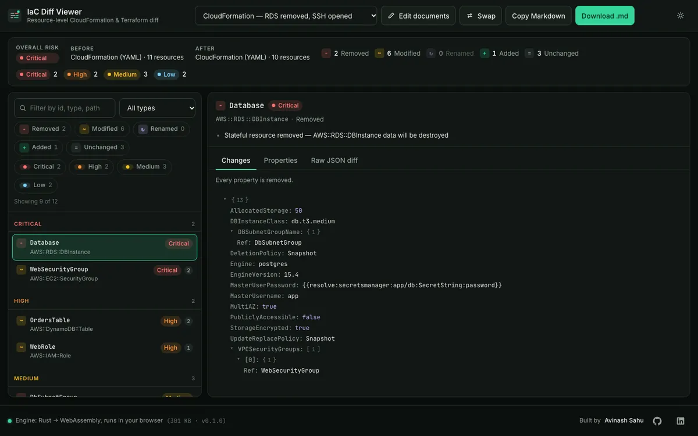
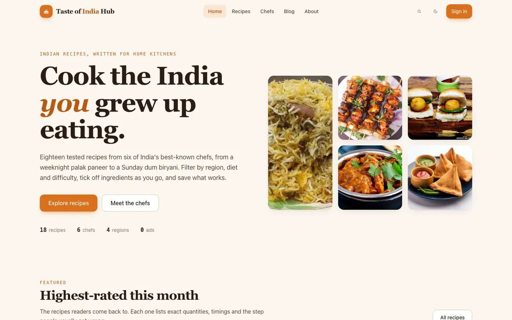
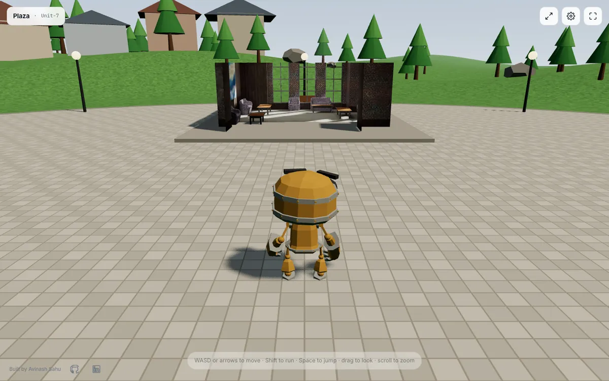
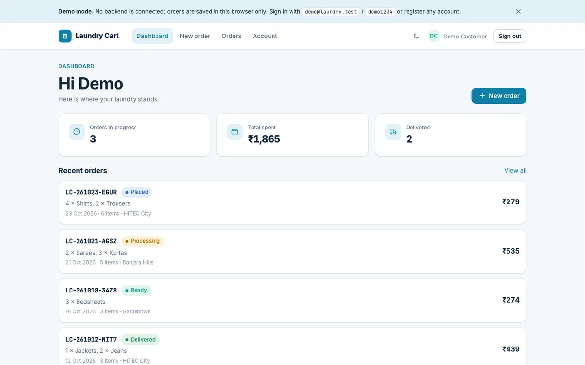

  

  
  
  
  

I build web and desktop software that stays correct when the network, the third-party API or the user misbehaves. Four-plus years across React, TypeScript, Node and Rust, lately on a Tauri + React + Rust desktop app that scans AWS and Azure estates, surfaces findings and runs AI-assisted playbooks: Cognito and OAuth auth, Lexical rich text, DynamoDB telemetry that survives offline, and Jira, Linear and Slack integrations.

## Selected work

Every project is deployed, tested and open source. Most started as a problem at work: an IAM policy I did not trust, an SSE stream that silently renamed an event, a Terraform diff too noisy to review.

<table>
  <tr>
    <td width="50%" valign="top">
      
      <h3><a href="https://avinash9694.github.io/iam-policy-analyzer/">IAM Policy Analyzer</a> · <a href="https://github.com/Avinash9694/iam-policy-analyzer">source</a></h3>
      
Paste an AWS IAM policy, get a 0–100 risk score and ranked findings: wildcards, privilege-escalation paths such as PassRole + Lambda, public principals, missing MFA/TLS conditions, each with a copyable fix. Deny statements mark what they neutralise. Runs entirely in the browser.

      
<code>React</code> <code>TypeScript</code> <code>AWS IAM</code> <code>Static analysis</code> <code>112 tests</code>

    </td>
    <td width="50%" valign="top">
      
      <h3><a href="https://avinash9694.github.io/cloud-audit-mcp/">Cloud Audit MCP Server</a> · <a href="https://github.com/Avinash9694/cloud-audit-mcp">source</a></h3>
      
Fourteen read-only AWS posture checks across S3, EC2, RDS, IAM and CloudTrail, exposed as Model Context Protocol tools for Claude and Cursor. A credential-free fixture mode for demos, and a test that fails if any mutating SDK command is ever imported.

      
<code>TypeScript</code> <code>MCP</code> <code>AWS SDK v3</code> <code>Zod</code> <code>99 tests</code>

    </td>
  </tr>
  <tr>
    <td width="50%" valign="top">
      
      <h3><a href="https://avinash9694.github.io/sse-stream-inspector/">SSE Stream Inspector</a> · <a href="https://github.com/Avinash9694/sse-stream-inspector">source</a></h3>
      
Parse, replay and diff Server-Sent Events streams. Flags the same event arriving under two spellings with different payload shapes, shape drift, duplicate or regressing ids, long silences and missing terminal frames. Web Worker parsing and a virtualised timeline handle 10k frames.

      
<code>React</code> <code>TypeScript</code> <code>Web Workers</code> <code>107 tests</code>

    </td>
    <td width="50%" valign="top">
      
      <h3><a href="https://avinash9694.github.io/iac-diff-viewer/">IaC Diff Viewer</a> · <a href="https://github.com/Avinash9694/iac-diff-viewer">source</a></h3>
      
Resource-level semantic diff of CloudFormation and Terraform documents with risk tagging and plain-English reasons. The engine is a Rust crate compiled to a 300 KB WebAssembly module, so nothing leaves the browser.

      
<code>Rust</code> <code>WebAssembly</code> <code>React</code> <code>Terraform</code> <code>115 tests</code>

    </td>
  </tr>
  <tr>
    <td width="50%" valign="top">
      
      <h3><a href="https://avinash9694.github.io/Ecommerce-APP/">Northline storefront</a> · <a href="https://github.com/Avinash9694/Ecommerce-APP">source</a></h3>
      
Full-stack e-commerce: an Express + MongoDB API with JWT auth, stock-enforcing carts and an order status machine, and a React storefront whose data layer swaps between the real API and an in-browser demo adapter, so it runs on GitHub Pages without a server.

      
<code>React</code> <code>Express</code> <code>MongoDB</code> <code>TanStack Query</code> <code>133 tests</code>

    </td>
    <td width="50%" valign="top">
      
      <h3><a href="https://avinash9694.github.io/TasteOfIndiaHub/">Taste of India Hub</a> · <a href="https://github.com/Avinash9694/TasteOfIndiaHub">source</a></h3>
      
Recipe site rebuilt from Create React App to Vite + TypeScript: ingredient search with chef, region, diet and difficulty facets over Zod-validated data, persistent ingredient checklists, and Firebase auth that is lazy-loaded and degrades gracefully.

      
<code>React</code> <code>TypeScript</code> <code>Tailwind CSS</code> <code>Firebase</code> <code>46 tests</code>

    </td>
  </tr>
  <tr>
    <td width="50%" valign="top">
      
      <h3><a href="https://avinash9694.github.io/3D-Virtual-Environment/">3D Virtual Environment</a> · <a href="https://github.com/Avinash9694/3D-Virtual-Environment">source</a></h3>
      
Walkable three.js world: pick one of three animated avatars and explore with WASD or an on-screen joystick behind a third-person spring camera. The original 35 MB scene was compressed to 486 KB with a reproducible glTF pipeline.

      
<code>three.js</code> <code>TypeScript</code> <code>WebGL</code> <code>glTF</code> <code>59 tests</code>

    </td>
    <td width="50%" valign="top">
      
      <h3><a href="https://avinash9694.github.io/Laundry-cart-frontend/">Laundry Cart</a> · <a href="https://github.com/Avinash9694/Laundry-cart-frontend">frontend</a> · <a href="https://github.com/Avinash9694/Laundry-cart-backend">API</a></h3>
      
Order management for a laundry service: a four-step garment and wash-type wizard with a live price breakdown, order history with a status timeline, and an Express/Mongoose API that owns pricing and validates every input with Zod.

      
<code>React</code> <code>TypeScript</code> <code>Express</code> <code>MongoDB</code> <code>100 tests</code>

    </td>
  </tr>
</table>

## Stack

  
  
  
  
  
  
  
  
  
  
  
  
  
  
  
  

## How I work

- **Correctness first.** Every async path has loading, empty and error states, and a failure is logged where someone will read it.
- **Tests on the logic that matters**, not on the framework. The projects above carry 770 automated tests between them.
- **A history a reviewer can follow.** Small conventional commits, one coherent step each.

Portfolio: <a href="https://avinash9694.github.io">avinash9694.github.io</a> · Resume: <a href="https://avinash9694.github.io/Avinash_Sahu_Resume.pdf">PDF</a>

